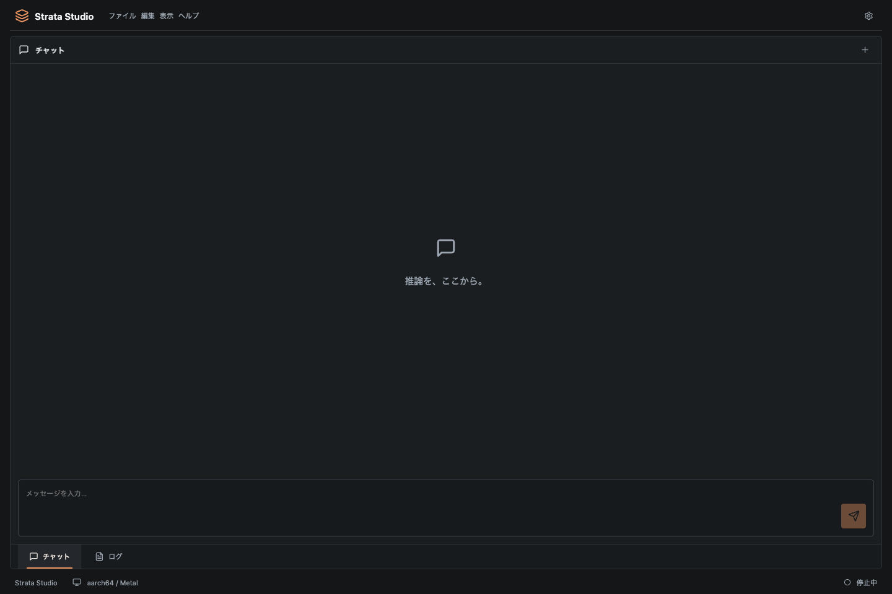

# Strata Studio



[日本語](README.ja.md) · [简体中文](README.zh-CN.md)

A Tauri 2 inference workbench and Rust API gateway for the existing [Strata](https://github.com/Niko1221/Strata) engine. macOS builds target Apple Silicon; inference uses Strata's native Metal backend. The upstream source in `Strata/` is unchanged.

## Run

```sh
npm ci
npm run desktop
```

The desktop app owns its loopback API server on `127.0.0.1:8080`. Do not run the standalone server at the same time.

For a browser workbench or a headless API gateway:

```sh
npm run build
cargo run -p studio-server --release
```

Open `http://127.0.0.1:8080`. For frontend development, run `npm run server` and `npm run dev` in separate terminals, then open `http://127.0.0.1:5180`.

## Connect the engine

Open **Strata Studio → Preferences… → Engine**. Set the Strata directory, an absolute Python 3.10+ interpreter path with Strata's dependencies, and a `strata-*.json` configuration produced by upstream setup. Start the engine. The `.venv/bin/python` interpreter and existing configurations are detected on first launch.

For API testing without model files, select **Test engine**. This uses the upstream mock engine; its outputs and logged speeds are not real inference measurements.

Real inference requires the upstream Metal executable, prepared model pack, and tokenizer. Follow [Strata's Mac guide](Strata/docs/MAC.md) to prepare these. Use the Preferences → Engine’s **Prepare model** icon to check paths/Python, select an existing config, or prepare one of the six supported Metal models. The preparation dialog shows model download and working-space estimates. A new download starts only after checking the capacity consent box and pressing **Prepare model**. Setup runs in a dedicated Strata `.venv`, streams its logs, can be stopped, and applies the generated config/Python path on success. It keeps the inference engine stopped. Studio does not download a model automatically. On the development Mac (32 GiB), upstream uses SSD expert streaming and keeps its memory protection defaults.

On Apple Silicon, Studio automatically caps context and prompt buffers by physical memory, reapplies them after model preparation and before startup, and preserves existing smaller limits. The 32 GiB profile uses 8K context and chunks of 64. See [Mac memory policy](docs/MAC_MEMORY.md). Preferences → Engine now shows automatic/active memory values and supports Manual context, prompt batch and macOS reserve settings. Use Apply & restart to save and restart in one action, including while running; plain Apply saves while stopped. Values survive re-preparation. The Engine tab also shows live system-wide memory, available memory and a before-change comparison; these include reclaimable cache and other apps, not only Strata. Memory history charts compare Mac-wide usage and the Strata process over 2, 5 or 10 minutes, with settings, start/stop and inference markers. Rust keeps recording while chatting; history resets on app exit.

The logo opens About, Preferences and Quit. File/Edit/View/Help menus provide conversation export, text editing and workspace switching. Preferences has **General** (language), **Engine**, and **API** tabs. Switch the main workspace using the **Chat / Logs** tabs at the bottom. `⌘,` opens Preferences; `⌘N` starts a new conversation; `⌘1` / `⌘2` switch the workspace. File → Export conversation saves JSON through a native save dialog (browser builds download JSON).

Configuration, conversation, and in-flight generated text belong to Rust. Configuration and conversation survive restart; selected UI tabs and the unsent composer are temporary interaction state. Path fields retain their native file/folder pickers.

## Local model discovery

Open **Preferences → Engine → Local models** (folder/search icon), also available from **Prepare model**. The library scans automatically when opened; Refresh scans again. Add a custom folder using the path field or the desktop folder picker. Removing a search folder only removes the location from Studio settings.

| Source | Locations inspected |
| --- | --- |
| Strata | Source tree, sibling `Strata-data`, upstream `data_dir`, and model/pack paths in the selected run config |
| LM Studio | `~/.lmstudio/models`, legacy `~/.cache/lm-studio/models`, `downloadsFolder` / `modelsDirectory` from its settings |
| Unsloth Studio | Studio HF cache, exports/models, `~/.unsloth/.cache`, shared HF cache, stored HF cache home/history and cache environment overrides |
| Ollama | `~/.ollama/models`, `OLLAMA_MODELS`; the standard Linux service location on Linux |
| Custom | Up to 32 saved absolute paths or `~/…` paths, including mounted volumes |

The Rust inventory reads filesystem metadata and a 24-byte model header, follows model-cache symlinks with cycle protection, and deduplicates physical files. Ollama manifests supply names for extensionless GGUF blobs. SafeTensors/PyTorch and Strata expert-pack files are listed separately. Scanning alone does not establish inference readiness. Select a row to check and use it as described below.

Scans run on the Rust blocking pool and cache results for 30 seconds. Traversal is bounded to 100,000 entries, 2,000 model files, depth 16 and a 15-second traversal budget; incomplete scans and inaccessible folders are shown. Narrow the custom search path when a limit is reached. The authenticated `GET /studio/models` endpoint returns metadata; `?refresh=true` bypasses the cache. `npm run test:models` verifies folder persistence, filtering, classification, three languages and responsive layouts; Rust fixtures also cover all providers, location overrides, Ollama naming, symlinks/hardlinks, cycles and old settings.

### Select and reuse a model

Select a model in the library, then press **Use in Strata**. If a usable Strata configuration already references that file or pack, Studio activates it immediately. Otherwise the current Metal preparation path accepts complete Qwen3.8-Flash-Next GSQ-RCO **Q2_0 / IQ3_XXS / IQ3_S** pairs and Unsloth **UD-Q4_K_XL / UD-Q5_K_XL / UD-Q6_K_XL** shard sets with upstream filenames. The selected logical cache path is retained so HF snapshot filenames are available even when their targets are hash-named blobs. Other models/formats require their own supported runtime/configuration and are refused by this preparation path.

Before preparation, a bounded header inspection uses Strata's GGUF reader to check `qwen4exp`, split indexes/counts, duplicate/incomplete tensor sets and tensor bounds. Missing, inconsistent or truncated shards stop before setup. The reuse job creates symlinks in `Strata-data/local-models/<model>-<fingerprint>/sources`; original model files and their completion markers are untouched. It calls upstream Metal setup with `--gguf-dir` through an in-memory adapter that treats the validated source links as complete and blocks weight downloads, isolates generated artifacts from upstream's file migration, and disables optional MTP checkpoint fetching. Model weights are not re-downloaded; tool/source archives, Python dependencies, engine compilation and derived pack/repack output may still be required. Workspace estimates exclude the existing model download size.

The supervised job supports logs/cancel, verifies the generated engine/tokenizer config and applies it on success. The engine stays stopped until **Start**. Failure retains the previous active settings and never falls back to downloading the model. `npm run test:reuse` checks real API selection, missing-shard refusal, config activation, supervised fixture preparation with zero model downloads, localization and narrow selection layouts. Rust tests also verify unchanged source bytes/sidecars and the download guard. Real large-model build/inference remains pending on this development machine.

Location references: [LM Studio](https://lmstudio.ai/docs/app/advanced/import-model), [Ollama](https://docs.ollama.com/faq#where-are-models-stored), [Unsloth storage roots](https://github.com/unslothai/unsloth/blob/main/studio/backend/utils/paths/storage_roots.py) and [Unsloth HF cache settings](https://github.com/unslothai/unsloth/blob/main/studio/backend/utils/hf_cache_settings.py).

## API

Copy the **Session API key** from **Preferences → API**. The key rotates when Studio restarts and is not saved. Use it as `Authorization: Bearer`, `x-api-key`, or `x-studio-token`.

| Route                       | Behavior                                                                        |
| --------------------------- | ------------------------------------------------------------------------------- |
| `GET /v1/models`            | Loaded model list                                                               |
| `POST /v1/chat/completions` | OpenAI-compatible JSON or SSE                                                   |
| `POST /v1/messages`         | Anthropic-compatible JSON or SSE                                                |
| `POST /v1/responses`        | Upstream Responses API passthrough                                              |
| `GET /status`               | Upstream inference state                                                        |
| `GET /health`               | Gateway health; does not imply the model is ready                               |
| `GET /studio/inspect`       | Authenticated path/config/Python diagnostics and Metal model capacity estimates |
| `GET /studio/state`         | Authenticated shared application state, engine health, bounded logs             |

Only loopback listeners are supported. The upstream Python server uses a separate private port and key. Responses stream through Rust without buffering the complete answer. Model weights, frame data, and GPU buffers never enter a WebView.

The standalone gateway accepts `STRATA_ROOT`, `STUDIO_PORT` (default `8080`), and `STUDIO_STATE_PATH` (default `.studio-state.json` in the working directory). The desktop app saves settings and conversation to its application data directory as `studio.json`. Saved state contains conversation text; remove that file to reset it.

## Build and verify

```sh
npm run build
cargo check --workspace --locked
cargo test -p studio-core --locked
npm run desktop:build -- --bundles app --no-sign
```

Production builds use Thin LTO, one codegen unit, and stripped symbols; the desktop build command targets `aarch64-apple-darwin` and macOS 15+. Signing/notarization requires the distributor's Apple credentials.

For end-to-end tests, keep the Rust server and Vite running, install the Playwright Chromium runtime (`npx playwright install chromium`), then run `npm run test:e2e`. `STUDIO_TEST_PYTHON` selects the test interpreter; `PLAYWRIGHT_CHROMIUM_EXECUTABLE` can select an existing Chromium installation. Use an isolated `STUDIO_STATE_PATH` for test runs and keep the desktop app closed. `npm run test:roadmap` additionally checks preparation diagnostics, config discovery/selection, consent enforcement without downloading, tabbed preferences and workspace navigation. `npm run test:menus` checks menus, About, editing, export, shortcuts, three locales and responsive preferences. Rust tests use a fake setup script to verify completion, failure, cancellation and environment isolation without model downloads. The base test covers lifecycle, streamed GUI chat, API compatibility/authentication, three languages, and 320/375/414/768/1440px widths.

See [architecture](docs/ARCHITECTURE.md) and [roadmap](docs/ROADMAP.md).
