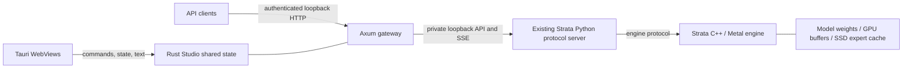

# Strata Studio architecture

## Inspected upstream

Local Strata revision: `296b59d2f73c8f04a805df29c2fa97655adace78`, engine version `0.1.44.1`. The upstream checkout remains unchanged.

| Directory                                                   | Role                                                                                               |
| ----------------------------------------------------------- | -------------------------------------------------------------------------------------------------- |
| `Strata/src`, `Strata/include/strata`                       | C++ host, artifacts, planning, prefill, speculative decoding, GPU backends                         |
| `Strata/metal`                                              | Separate macOS CMake project: Metal runtime, GPU kernels, compatibility layer, Apple Silicon setup |
| `Strata/serve/server.py`                                    | OpenAI/Anthropic/Responses protocol handling, request queue, engine lifecycle                      |
| `Strata/serve/frontend.py`                                  | Chat template and output parsing                                                                   |
| `Strata/serve/runconfig.py`                                 | Upstream run configuration semantics                                                               |
| `Strata/setup.py`, `Strata/metal/setup_mac.py`              | Runtime installation, native builds, model preparation, generated run configs                      |
| `Strata/tests`, `Strata/metal/tests`, `Strata/serve/test_*` | Existing engine, Metal, API regression suites                                                      |

## Runtime boundaries

`studio-core` owns Document, Settings, child process, bounded logs, gateway authentication, streamed conversation updates and atomic state saves. `studio-server` runs the same core without Tauri. `src-tauri` owns native windows and passes their operations to the shared core. `src` renders state and maintains only temporary interaction drafts.

The API server does not translate model formats or duplicate upstream sampling/tool-call behavior. `/v1/*` is forwarded to the existing protocol implementation. GUI chat uses `/studio/chat`, which updates Rust's conversation during each SSE delta and rejects concurrent document mutations. External API conversations remain caller-owned, as in the upstream API.

Apple Silicon inference stays in the upstream native Metal implementation; no GPU buffers or large frame data cross the Rust/JavaScript boundary. This workbench has no heavy image/canvas renderer, so it does not introduce an unused wgpu renderer. Future heavyweight visualization should be implemented in a Rust wgpu renderer with command/state-only IPC.

## Lifecycle and storage

The Python server and its engine run in a dedicated Unix process group. Stop/desktop exit sends SIGTERM, waits up to eight seconds, then kills the group if needed. Unexpected exit is reflected as offline. Python version/dependencies and config existence are checked before launch. A port occupied by another application is not silently reused.

The gateway is loopback-only and authenticated. Its public session key is separate from the private upstream key. The browser session bootstrap accepts only the gateway's own origin or the local Vite origin. No external-origin CORS access is granted. API key headers from clients are replaced by the private upstream key.

Settings and conversation are written atomically; Unix saved-state permissions are `0600`. The session key is not saved. In-flight generation and detached-window flags reset after restart. Logs retain at most 300 lines of 4096 characters; ordinary proxied request bodies are limited to 16 MiB. This is a local desktop application, with no cloud service dependency.

## Verification scope

Development hardware reports Apple Silicon (`aarch64`), 32 GiB unified memory, macOS 27.0.1. Rust core tests cover authentication, missing-model configuration, atomic save/reload and reset of transient flags. Browser E2E covers upstream mock lifecycle, Rust-owned streamed chat, OpenAI models/SSE, Anthropic JSON, authorization, offline response, languages and responsive widths. Native Tauri tests cover floating engine/API windows, docking, window-close restoration and mock chat. Real model accuracy/performance is pending; no model pack or built native inference executable was supplied.
