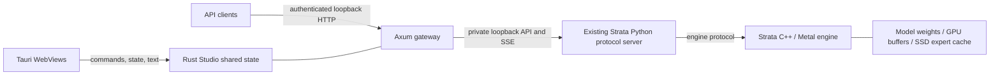

# Strata Studio architecture

## Inspected upstream

Local Strata revision: `296b59d2f73c8f04a805df29c2fa97655adace78`, engine version `0.1.44.1`. The upstream checkout remains unchanged.

| Directory                                                   | Role                                                                                               |
| ----------------------------------------------------------- | -------------------------------------------------------------------------------------------------- |
| `Strata/src`, `Strata/include/strata`                       | C++ host, artifacts, planning, prefill, speculative decoding, GPU backends                         |
| `Strata/metal`                                              | Separate macOS CMake project: Metal runtime, GPU kernels, compatibility layer, Apple Silicon setup |
| `Strata/serve/server.py`                                    | OpenAI/Anthropic/Responses protocol handling, request queue, engine lifecycle                      |
| `Strata/serve/frontend.py`                                  | Chat template and output parsing                                                                   |
| `Strata/serve/runconfig.py`                                 | Upstream run configuration semantics                                                               |
| `Strata/setup.py`, `Strata/metal/setup_mac.py`              | Runtime installation, native builds, model preparation, generated run configs                      |
| `Strata/tests`, `Strata/metal/tests`, `Strata/serve/test_*` | Existing engine, Metal, API regression suites                                                      |

## Runtime boundaries

`studio-core` owns Document, Settings, child process, bounded logs, gateway authentication, streamed conversation updates and atomic state saves. `studio-server` runs the same core without Tauri. `src-tauri` owns native windows and passes their operations to the shared core. `src` renders state and maintains only temporary interaction drafts.

The API server does not translate model formats or duplicate upstream sampling/tool-call behavior. `/v1/*` is forwarded to the existing protocol implementation. GUI chat uses `/studio/chat`, which updates Rust's conversation during each SSE delta and rejects concurrent document mutations. External API conversations remain caller-owned, as in the upstream API.

Apple Silicon inference stays in the upstream native Metal implementation; no GPU buffers or large frame data cross the Rust/JavaScript boundary. This workbench has no heavy image/canvas renderer, so it does not introduce an unused wgpu renderer. Future heavyweight visualization should be implemented in a Rust wgpu renderer with command/state-only IPC.

## Lifecycle and storage

The Python server and its engine run in a dedicated Unix process group. Stop/desktop exit sends SIGTERM, waits up to eight seconds, then kills the group if needed. Unexpected exit is reflected as offline. Python version/dependencies and config existence are checked before launch. A port occupied by another application is not silently reused.

The gateway is loopback-only and authenticated. Its public session key is separate from the private upstream key. The browser session bootstrap accepts only the gateway's own origin or the local Vite origin. No external-origin CORS access is granted. API key headers from clients are replaced by the private upstream key.

Settings and conversation are written atomically; Unix saved-state permissions are `0600`. The session key is not saved. In-flight generation and detached-window flags reset after restart. Logs retain at most 300 lines of 4096 characters; ordinary proxied request bodies are limited to 16 MiB. This is a local desktop application, with no cloud service dependency.

## Verification scope

Development hardware reports Apple Silicon (`aarch64`), 32 GiB unified memory, macOS 27.0.1. Rust core tests cover authentication, missing-model configuration, atomic save/reload and reset of transient flags. Browser E2E covers upstream mock lifecycle, Rust-owned streamed chat, OpenAI models/SSE, Anthropic JSON, authorization, offline response, languages and responsive widths. Native Tauri tests cover floating engine/API windows, docking, window-close restoration and mock chat. Real Q2_0 inference has now been verified on the M4 through native GUI chat and the API; extended accuracy/performance testing remains pending.

## Model preparation and workspace chrome

`preparation.rs` inspects Python and generated configs without importing or executing setup. The setup job is opt-in: model names are an allowlist, capacity is reviewed before launch, and `confirmed: true` is required. The job bootstraps an isolated `.venv` under the selected source root, verifies that it is not a shared environment, then execs the official `metal/setup_mac.py` with `--yes --setup --no-start --no-browser --vision no` and an explicit model/context/data directory. Inference startup and settings changes are locked while preparation runs. The process group supports interruption with a kill fallback. Completion applies the expected model config only when its engine and tokenizer paths exist; failure/cancellation preserve the previous config. Download/working-space numbers are estimates from the inspected upstream model definitions, not measured transfer or inference results. Optional expert copies can require more disk.

The main WebView displays a single Chat/Logs workspace with bottom tabs. Preferences groups General, Engine and API settings in a modal dialog. Menus support keyboard navigation, Escape, outside-click dismissal and viewport-aware placement. Selected tabs, menu focus, selection ranges and unsent text are temporary interaction state; settings and conversation remain in Rust. Native export snapshots the Rust conversation, opens a save picker and writes JSON; native Quit shuts down managed processes before app exit. Legacy floating-window and validated dock-geometry commands remain available for compatibility, but the main UI no longer exposes side docks.

Verification covers setup diagnostics and consent, three dialog languages, responsive preferences and menus, keyboard tab/menu navigation, editor selection/undo, JSON export, streamed mock chat and API compatibility. Real model download/build/inference has also been verified; see LOCAL_INFERENCE_VERIFICATION.md.

## Model inventory

`catalog.rs` owns location discovery and a 30-second Rust-side cache. `Settings.modelDirectories` defaults to an empty array when old saved settings are loaded. The authenticated `/studio/models` route serializes scans through a mutex and offloads filesystem work to the blocking pool. Source configuration and environment locations are inspected without importing another application's Python code; Unsloth's two HF location settings are queried via a read-only SQLite connection. Ollama model layers are identified from manifests and GGUF headers. Canonical directories prevent cycles; Unix device/inode identity collapses symlinks and hardlinks while retaining source labels. Traversal and output bounds prevent an unbounded WebView list; the UI initially renders 50 filtered results.

The inventory transfers paths, sizes, format and detection status, never weights. Scanning does not activate models; the separate local selection flow below performs preparation checks. Custom folder removal affects only Studio settings.

## Local selection and preparation

`local_model.rs` resolves existing configs or the six allowlisted upstream shard filename sets. The inventory preserves a logical `selectionPath` alongside canonical paths for HF symlinks. `local_validate.py` uses the selected Python and upstream GGUF header reader without network or tensor-data reads, with bounded reads/counts and a 30-second timeout. It checks architecture, split consistency, tensor count/uniqueness, known tensor byte geometry and file bounds. Preparation revalidates on confirmation and rejects changed source/Python settings before taking the lifecycle path.

Local inputs share `preparation.rs` lifecycle/process-group supervision. Source symlinks live under a fingerprinted Studio workspace. An in-memory Python adapter passes `--gguf-dir`, overrides completion checks only for those links, forbids non-tool/archive downloads, bypasses upstream data-file migration, and disables optional MTP fetching. Upstream files are unchanged. Generated pack/repack files and source-sidecars belong to the Studio workspace; original weights remain in their stores. Existing config activation is locked against engine/preparation activity; successful preparation applies its config without automatically starting inference. A local-job flag keeps the progress dialog at zero model download and prevents accidental fallback to the download workflow.

Fixtures cover missing/mixed/truncated shards, logical-to-physical links, unchanged sources, existing config activation, a supervised preparation that asserts the download guard and optional MTP suppression, and UI selection through completion in three languages. Real Q2_0 local-file preparation and inference have also been verified; see LOCAL_INFERENCE_VERIFICATION.md.

## Mac memory policy

`metal_policy.rs` owns capacity-based context and prompt-chunk limits. Preparation passes the profile context to upstream setup, then applies the policy atomically before accepting the generated Metal config. Startup reapplies it to imported or externally regenerated configs. Existing smaller limits and unrelated settings survive; invalid configs fail without replacement. The engine's arena and memory-reserve rules are unchanged. `/studio/inspect` exposes `metalProfile`; startup logs the effective values. See [policy table](MAC_MEMORY.md).

Preferences exposes `MemoryControls` in English, Japanese and Simplified Chinese. `Settings.metalMemory` stores auto/manual mode plus context, prompt chunk and macOS reserve. Rust validates ranges and rejects memory changes while a managed engine is running or preparation is busy. Both preparation arguments and post-setup/startup config application use the saved values. Config metadata tracks Studio-written values so switching back to auto removes a previous manual override. Snapshot `memoryTuning` separates automatic recommendations, the next launch preview and the running process's applied settings.

`applyMemoryRestart` accepts only memory settings, validates them before stopping, and serializes stop/save/start with the lifecycle mutex. Chat registers generation under that mutex so the operation refuses an active reply without interrupting it. Plain settings updates still cannot alter memory while running. Save failure restores previous settings and attempts recovery; startup failure reports that the new values remain saved.

`memory_usage.rs` owns a cached, system-wide Mach VM sample and a transient before-change reference. Snapshot `memoryUsage.current` reports total/used/available/free bytes and an epoch-millisecond timestamp; `beforeChange` is captured before the stop phase of apply/restart or a plain memory save. Sampling uses the upstream reclaimable-memory formula, one retained host right and no polling subprocess. Errors produce null, never fabricated zero readings. Comparison state stays in Rust across WebViews but is not persisted across app relaunch.

メモリ履歴は `serve` と同じライフタイムのRustサンプラーが約1秒ごとに更新する。ウインドウは履歴を所有せず、上限付きの数値列とイベントをSVGに描画する。推論リクエストのガードはストリーム終了・失敗・切断で区間を閉じる。

## Conversation library

`conversations.rs` owns active conversation identity, activity timestamps and archived message arrays within Rust `Document`. New Chat archives a non-empty active conversation; switching restores the chosen messages and archives the current ones. Empty drafts do not accumulate. Titles use the first user message (80 characters). `/studio/state` returns active messages and summary rows only; inactive bodies stay in Rust and the existing atomic storage file. Old single-conversation documents acquire a library identity on load without discarding their messages.

`newConversation`, `switchConversation` and `deleteConversation` actions use the Document write lock and reject generation in progress. Deleting the active conversation starts an empty one; the UI requires a second explicit click after its deletion notice. The library allows up to 50 conversations and caps combined message text at 64 MiB when archiving. Export the selected conversation through File before deleting it if needed. GUI chat requests include `conversationId`; stale-window submissions are rejected before appending messages. Legacy API clients without that field retain their current-active-conversation behavior.

Appearance lives in shared Rust Settings (`chatFontSize`, `theme`), with defaults 13 px/dark for old files. The `appearance` action validates partial updates without changing engine settings or generation state. WebViews apply semantic color tokens and `--chat-font-size` to conversation text and the composer; Tauri window theme follows the saved mode.

`inference.rs` incrementally parses OpenAI/Anthropic SSE and JSON, including CRLF and split UTF-8. It stores response-reported usage/timings separately from gateway-clock latency. Chat messages carry optional inference metadata (old files remain readable); API requests keep only metrics in a bounded shared 100-record deque. Completed, cancelled and failed streams remain distinguishable. Restoring an interrupted chat clears its running state and unknown final duration. See [inference display and metrics](INFERENCE.md).
